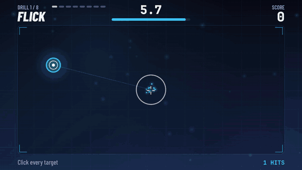
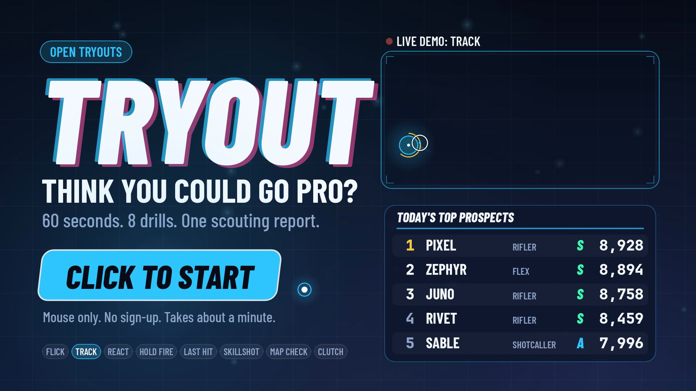
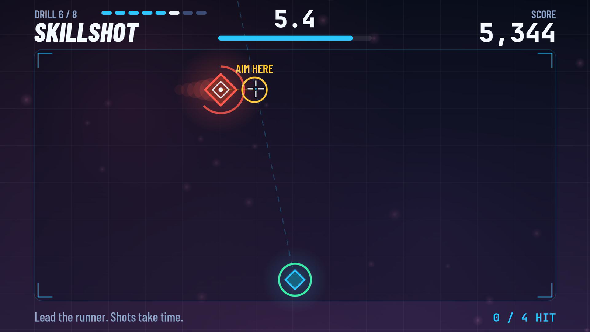
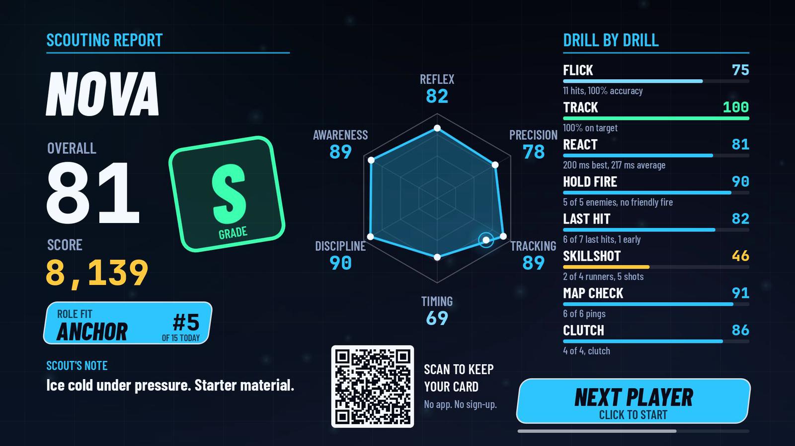
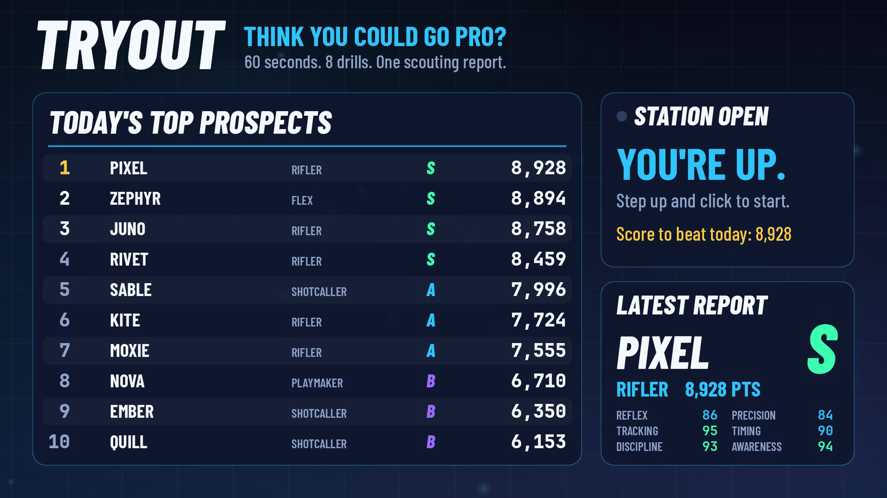

# Tryout

**Think you could go pro? Sixty seconds, eight drills, one scouting report.**

Tryout is a mini game for esports event booths. A fan walks up, clicks once, plays eight quick drills that each test a skill competitive players train, and walks away with a scouting report: an overall rating, a grade, a role fit and a place on the booth leaderboard. A turn takes about a minute and a half, so the line keeps moving.

Built for the Cloud9 x JetBrains "Sky's The Limit" Hackathon 2026, Category 3 (Event Mini Game).

## Play it

- **In a browser:** https://osakr6604-create.github.io/tryout/
- **On Windows:** download `Tryout-windows.zip` from the [latest release](https://github.com/osakr6604-create/tryout/releases/latest), unzip, run `Tryout.exe`.

Mouse only. No account, no install, no network needed once it is on the machine.

## The eight drills

Every player gets the same eight drills in the same order, which keeps the leaderboard fair. Each one is introduced by a single word on screen and lasts about six seconds.

| Drill | What you do | What it measures |
| --- | --- | --- |
| Flick | Click each target as it appears | Aim speed and accuracy |
| Track | Keep the pointer on a target that wanders and speeds up | Smooth tracking |
| React | Wait for the peek, then click | Raw reaction time, shown in milliseconds |
| Hold fire | Click the red diamonds, leave the blue circles alone | Trigger discipline |
| Last hit | Click a bar the moment it turns gold | Timing |
| Skillshot | Shots take time to travel, so aim where the runner will be | Prediction |
| Map check | Six pings flash on a radar, then vanish. Click where they were | Awareness and recall |
| Clutch | Four opponents peek one after another. Five bullets | Composure under pressure |

## The scouting report

The run ends with a report that reveals itself step by step: six attributes on a radar chart, an overall number, a grade from D to S+, a role fit (Entry, Marksman, Rifler, Playmaker, Anchor, Shotcaller or Flex), a one-line scout's note and the player's place on today's board.

A QR code on the report gives each player their own card to keep. The card travels inside the link itself, so the booth PC needs no connection and nothing about the player is stored anywhere.

## Built for a booth

- **Learned in seconds.** One word and one line of instruction before each drill. The first skillshot target shows where to aim.
- **Fast turns.** About a minute of play, about a minute and a half per player, roughly 35 to 40 players an hour.
- **Looks after itself.** Every screen has a way out that needs no input. Abandoned runs are dropped. The report resets on a timer.
- **A leaderboard for the crowd.** Plug in a second screen and the top ten opens on it, with what the current player is doing and the latest report. Today and all-time.
- **Works with no Wi-Fi.** Scores are one small local file, saved through a temporary file with a backup of the last good copy.
- **Clean names on the big screen.** Tags are filtered before they are shown.
- **A menu for the crew.** Volume, screens, export to a spreadsheet, reset the board. Destructive buttons need a second click.
- **Your event's name, colour and logo** from a small settings file, without rebuilding.
- **An attract screen that plays itself.** A built-in demo player runs the real drills live, so the booth is never showing a still image.

The crew guide is in [docs/BOOTH.md](docs/BOOTH.md).

## How it is built

Godot 4.7, GDScript, one codebase for Windows, Linux and the browser.

The rules of each drill live in a small class with no nodes, no rendering and no clock of its own (`drills/*_model.gd`). The game feeds a model real frames and real clicks; the tests and the demo player feed it from a loop. That split is what makes the rest possible:

- **Tests** (`bash tools/test.sh`): 112 headless tests over the scoring curves, each drill's rules, the rating, the leaderboard and its file on disk, the tag filter and the QR code.
- **A demo player** (`bots/drill_bot.gd`) that plays like a person at a chosen skill level: it needs time to notice things, moves the pointer along a smooth path that takes longer for far or small targets, and misses more at low skill. It runs the attract screen, and the tests use it to check that better play always scores higher.
- **A soak test** (`bash tools/soak.sh 1000`): plays whole sessions back to back with the real scene tree and checks that the tree, the object count and the memory did not grow. `bash tools/soak.sh 60 render` does the same with the real renderer, which also covers font and texture memory.
- **A mouse check** (`bash tools/input-check.sh`): the demo player sends real mouse events through the engine's input system, so the start button, the drills, the on-screen keyboard and the booth menu are all exercised the way a person's mouse would.
- **A browser check** (`node tools/web-check.mjs`): plays the web build in headless Chrome and fails on any page error.
- **A QR code generator** (`core/qr.gd`) written for this project, with its output pinned to codes that were decoded by an independent reader.

All balance numbers are in one file, `core/tuning.gd`. The difficulty was tuned against the demo player at six skill levels (`dev/balance.gd` prints the table). It has not been tuned on a crowd of real players yet; a booth can adjust that one file.

Every sound is generated from code by `dev/bake_audio.gd`. All shapes are drawn from code. The only third-party assets are two open fonts.

## Build it yourself

1. Install [Godot 4.7.2](https://godotengine.org/download/archive/4.7.2-stable/) (standard build).
2. Open the folder in Godot and press F5, or run `godot --path .`
3. Tests: `GODOT_BIN=/path/to/godot bash tools/test.sh`
4. Builds: install the export templates for 4.7.2, then `bash tools/export.sh`

Useful launch flags (after `--` on desktop, or as `?flag&flag=value` in the browser address):

| Flag | Effect |
| --- | --- |
| `--windowed` | Start in a window |
| `--demo-board=14` | Fill the board with 14 runs played by the demo player |
| `--autoplay --skill=0.8` | Let the demo player play |
| `--board` | Open the leaderboard window on a single screen |
| `--mute` | No sound |

## Licence and credits

Code, art and sound: MIT, see [LICENSE](LICENSE).

Fonts: [Barlow Condensed](https://github.com/jpt/barlow) and [JetBrains Mono](https://github.com/JetBrains/JetBrainsMono), both under the SIL Open Font License 1.1 (licence files in `assets/fonts`).

Engine: [Godot](https://godotengine.org), MIT.

Tryout uses no logos, names, characters or art from any esports team, game or publisher.
